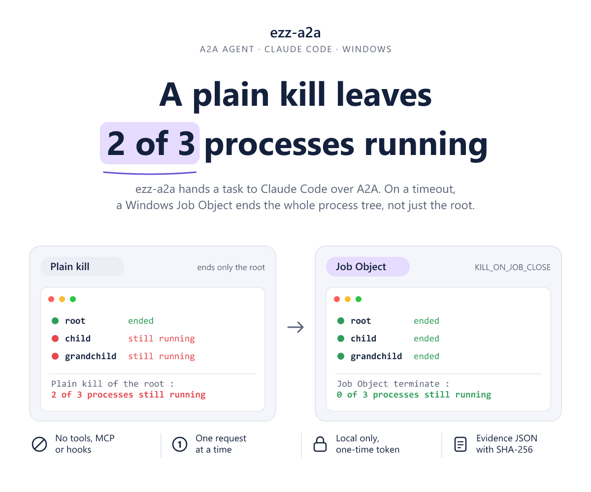

# ezz-a2a

A local [A2A](https://github.com/a2aproject/a2a-python) 1.0 agent that hands a
review task to Claude Code and returns the answer as a task artifact, with a
JSON evidence file of exactly what was sent and received.



An [animated walkthrough](docs/assets/ezz-a2a-flow.gif) shows the seven steps of one review.

You give it a task file listing the source files to review. It starts a
throwaway server on localhost, sends the task through the A2A protocol, runs
`claude -p` with no tools, and saves the result. Claude only sees the files you
list; it cannot read the repository or edit anything.

It uses the Claude Code CLI's existing login, so no API key is needed.
Whether a call works depends on your Claude account and quota.

## Requirements

- Python 3.11 or newer
- [Claude Code](https://code.claude.com/docs/en/headless) installed and signed in
- Windows, Linux or macOS. Claude and its child processes run in a Windows
  Job Object or a POSIX process group, so a timeout ends the contained tree.

## Install

Windows (PowerShell):

```powershell
uv venv .venv
uv pip install --python .venv/Scripts/python.exe -e ".[dev]"
```

Linux/macOS (Bash or Zsh):

```bash
uv venv .venv
uv pip install --python .venv/bin/python -e ".[dev]"
```

Without uv, use `python3 -m venv .venv` followed by
`.venv/bin/python -m pip install -e ".[dev]"` on Linux/macOS.
The package is called `ezz_a2a`; every command below runs one of its modules.

## Run a review

1. Copy `tasks/self-review.json` and edit it (format below).
2. Run:

```powershell
.venv/Scripts/python.exe -m ezz_a2a.review tasks/my-review.json --model sonnet --enable-claude --output evidence/my-review.json
```

On Linux/macOS:

```bash
cp tasks/self-review.json tasks/my-review.json
# Edit tasks/my-review.json before running the review.
.venv/bin/python -m ezz_a2a.review tasks/my-review.json --model sonnet --enable-claude --output evidence/my-review.json
```

The answer is printed and the full record is written to `--output`. The model
is required and has no fallback: use an alias your account can use. The
reviewer writes in English.

Without `--enable-claude` the whole pipeline runs but Claude is not called, so
the task ends as `failed`. Use that to check your task file and the transport
without spending quota.

Options: `--repository <dir>` (root that `files` are relative to, default: the
current directory), `--claude <path>` (explicit Claude executable; shell launchers
such as `.cmd` are rejected).

Claude is discovered through `PATH` or `~/.local/bin/claude` on Linux/macOS;
the file must be executable. Symlinks are resolved before the runner changes
directories. For another installation, pass `--claude /absolute/path/to/claude`.

### Task file

```json
{
  "id": "review-001",
  "objective": "Find concrete defects in the runner.",
  "base_commit": "0addfac",
  "dependencies": [],
  "files": ["ezz_a2a/claude/runner.py", "ezz_a2a/worker/executor.py"],
  "acceptance": ["Findings listed by severity with file and line"],
  "checks": ["pytest: 65 passed"]
}
```

All fields are required. `files` and `acceptance` cannot be empty.

- `files`: explicitly selected paths relative to the repository, with one of
  the supported extensions or exact filenames below. UTF-8 text only; no hidden
  files or folders except direct YAML files in the root `.github/workflows/`.
  Nothing under `evidence/` or `tasks/`.
  The whole prompt is limited to 100,000 characters.
- `checks`: results you ran yourself. Claude treats them as declared evidence,
  not as tests it executed.
- Do not include secrets or personal data: the contents are sent to Claude.

### Supported source files

| Language or framework | Extensions |
| --- | --- |
| Python | `.py` |
| Go | `.go` |
| Java | `.java` |
| JavaScript / Node.js | `.js`, `.mjs`, `.cjs` |
| TypeScript / Node.js | `.ts`, `.mts`, `.cts` |
| React | `.jsx`, `.tsx`, plus JavaScript, TypeScript and styles |
| Angular | `.ts`, `.html`, and styles |
| Vue | `.vue`, plus JavaScript, TypeScript and styles |
| PHP / Laravel | `.php`, including `.blade.php` templates |
| HTML and styles | `.html`, `.css`, `.scss`, `.sass`, `.less` |
| Configuration | `.yaml`, `.yml`, `.toml`, `.jsonc`, `.xml`, `.properties` |
| SQL and schemas | `.sql`, `.prisma` |
| API contracts | `.graphql`, `.gql`, `.proto` |
| Scripts | `.sh`, `.bash`, `.ps1` |
| JVM build scripts | `.gradle`, `.kts` |
| Infrastructure | `.tf`, `.hcl` |
| Supporting context | `.md`, `.json`, `.txt` |

Exact filenames are also supported: `Dockerfile`, `Containerfile`, `Makefile`,
`Jenkinsfile`, `go.mod` and `go.sum`, including inside non-hidden subdirectories.
Other files sharing their suffixes are not automatically accepted.

You can mix these files in one task, for example a Go handler, a React `.tsx`
component and its `.scss` styles. Select each file in `files`; directories are
not scanned automatically. Source text is sent as context for Claude to review;
the worker does not compile code, run framework tooling or execute tests.
The same scope checks, SHA-256 snapshots and 100,000-character prompt limit
apply to every supported language. The extension filter does not detect secrets
inside an allowed file.

### Excluded context

Both the selected path and its resolved target must pass the filter, so links
cannot hide a prohibited location or filename. The workflow exception permits
only `.github/workflows/<name>.yml` or `.yaml` directly under the repository root;
it does not open other `.github/` files, nested workflows or hidden filenames.

The filter rejects:

- `.env` files and other hidden paths; key/certificate formats such as `.key`,
  `.pem`, `.p12`, `.pfx`, `.jks`, `.keystore`, `.crt` and `.cer`.
- Formats outside the allowlist, including executable binaries, archives and
  source maps. Text files containing NUL bytes are also rejected.
- Files inside `node_modules/`, `vendor/`, `dist/`, `build/`, `target/`,
  `coverage/` or `__pycache__/`, at any depth.
- Names containing `.generated.` or `_generated.`, or ending in `.min.js`,
  `.min.css`, `.pb.go`, `_pb2.py` or `_pb2_grpc.py`.

These are conservative path and filename rules, not universal detection of
generated files or secrets. For example, a valid YAML file can still contain
credentials. Select and inspect configuration context before sending it.

### Output and exit codes

The evidence JSON holds the task, each source with its SHA-256, the model,
UTC start and end times, process IDs and the A2A response. It is never
overwritten: pick a new `--output` each time. It is written before anything is
printed, so a closed console does not lose a paid answer.

Each completed response also carries its usage under
`responses[].artifacts[].metadata`: `input_tokens`, `output_tokens`,
`cache_creation_input_tokens`, `cache_read_input_tokens`, `cost_usd`, `model`,
`duration_seconds` and `prompt_chars`. The token counts, cost and model are
copied from the JSON that `claude -p --output-format json` returns (`usage`,
`total_cost_usd`, `modelUsage`). `duration_seconds` is the
wall-clock time of the call, and `prompt_chars` the length of the prompt, both
measured locally. If the CLI omits or malforms a field, it is stored as `null`;
nothing is estimated. The printed answer text is unchanged.

To compare two saved reviews against a case of known real and known false
findings (`cases/records-known-findings/`: `records.py` of `kennethreitz/records` as of
February 2018, unmodified, with five defects that upstream later fixed or reported and three
false ones; its `README.md` has the review command), run
`python -m ezz_a2a.review.measure before.json after.json --case records-known-findings`
from the repository root, where both evidence files are looked up by name in `evidence/`.
It prints real findings found, false findings flagged, and the reported tokens
and cost side by side. Findings are matched by anchor terms, so a disputed
match should be settled by reading the answer.

| Code | Meaning |
| --- | --- |
| 0 | Task completed and evidence saved |
| 1 | Execution failed (task not completed, Claude unavailable, timeout) |
| 2 | Invalid task, output or setup; nothing was sent |
| 3 | Review ran but the evidence could not be saved; the kept file is named on stderr |
| 130 | Interrupted with Ctrl-C |

## Run the server and client by hand

For debugging. No evidence is saved and the server stays up.

```powershell
$env:A2A_TOKEN = [guid]::NewGuid().ToString('N')   # same value in both terminals
.venv/Scripts/python.exe -m ezz_a2a.worker --model sonnet --enable-claude
.venv/Scripts/python.exe -m ezz_a2a.client path/to/prompt.txt
```

Linux/macOS, in the server terminal:

```bash
export A2A_TOKEN="$(.venv/bin/python -c 'import secrets; print(secrets.token_urlsafe())')"
.venv/bin/python -m ezz_a2a.worker --model sonnet --enable-claude
```

In a second terminal, set `A2A_TOKEN` to the same value and run:

```bash
export A2A_TOKEN='<same value as the server terminal>'
.venv/bin/python -m ezz_a2a.client path/to/prompt.txt
```

The server listens on `127.0.0.1:9130` only (`--port` to change; `0` picks a
free one and prints `A2A_PORT=<port>`). Every request needs
`Authorization: Bearer $A2A_TOKEN`; the Agent Card is at
`/.well-known/agent-card.json`. The client sends the file as-is with no
filtering. Do not expose the port to a network.

## Demo: why the worker contains its process tree

Killing only Claude on a timeout leaves its child processes running. The
runner uses a Job Object on Windows and a process group on Linux/macOS. This demo
builds a three-level process tree and simulates a timeout both ways (no Claude
call, no quota):

```powershell
.venv/Scripts/python.exe -m ezz_a2a.demo
```

On Linux/macOS use `.venv/bin/python -m ezz_a2a.demo`. The demo requires
`ps` on `PATH` to inspect process state (including zombies).

```
Process tree of 3 levels, simulated timeout after it is up.

Plain kill of the root : 2 of 3 processes still running
Contained terminate    : 0 of 3 processes still running
```

On Windows, the worker starts suspended (`CREATE_SUSPENDED`), joins the job and
only then resumes (`NtResumeProcess`), so it cannot start a child outside the job.
Assigning the job after a normal start left that window open: with the event
loop held for 20 ms, 9 of 10 grandchildren escaped the job; started suspended, 0 of
10. If the job cannot be created, the request fails instead of running
uncontained. On Linux/macOS the group exists from process startup. The runner
kills it on timeout, cancellation and normal completion. Unlike a Windows Job
Object, a POSIX group does not automatically end if the worker crashes, and a
descendant that starts a new session can escape it.

## Safety and limits

- Claude runs with tools, MCP servers, hooks, slash commands and session
  persistence disabled, in an empty temporary directory, for one turn.
- `ANTHROPIC_API_KEY`, `ANTHROPIC_AUTH_TOKEN` and `A2A_TOKEN` are removed from
  its environment. Alternative providers (Bedrock, Vertex, Foundry, a custom base
  URL) are rejected.
- One request at a time (a second one fails as busy), 180 s timeout.
- Task state lives in memory. No streaming, remote cancel or retries.
- Not an OS sandbox, and it does not measure remaining quota.

## Development

Use named constants for timeouts, limits, exit codes and other numeric policy
values. Include units in names where relevant and keep constants in the module
that owns them; shared values belong in `ezz_a2a/settings.py`. Prefer standard
library enums for protocol values, such as `HTTPStatus`. Ordinary indices,
increments, empty counts and explicit test inputs or expected results may stay
literal when their meaning is clear from context.

```powershell
.venv/Scripts/python.exe -m pytest
```

On Linux/macOS:

```bash
.venv/bin/python -m pytest
.venv/bin/python -m ezz_a2a.demo
```

Tests never call Claude; they use synthetic processes and a local server. CI
runs them and the process-tree demo on `windows-latest` with Python 3.11,
including real descendant termination and real runner subprocesses on success,
timeout and cancellation. Linux/macOS checks are available locally, but the
current workflow does not validate those platforms; their platform-specific
tests are skipped on Windows.

### Verify an authenticated Claude installation

CI does not authenticate to Claude or consume quota. To validate the complete
integration, run the following on **each** Linux/macOS machine after installing
and signing in to Claude Code. The last command consumes Claude quota and sends
the source files listed in `tasks/self-review.json` to Claude. Select a model
your account can use and choose a fresh evidence path for each execution.

```bash
claude --version
.venv/bin/python -m pytest
.venv/bin/python -m ezz_a2a.demo
# Transport-only check: expected exit code 1 and FAILED, with evidence saved.
.venv/bin/python -m ezz_a2a.review tasks/self-review.json --model sonnet --output evidence/transport-check.json
# Authenticated check: expected exit code 0 and COMPLETED, with a review artifact.
.venv/bin/python -m ezz_a2a.review tasks/self-review.json --model sonnet --enable-claude --output evidence/claude-check.json
```

Keep the evidence private: it contains source snapshots and the returned review.
Passing synthetic CI tests does not establish Claude login, quota or CLI-version
compatibility on a user's installation.

```
ezz_a2a/
  worker/   A2A server: Agent Card, bearer auth, review executor
  claude/   contained, read-only `claude -p` runner, Job Object and POSIX group
  review/   task validation, throwaway local worker, evidence store, review CLI
  client/   A2A client and CLI
  demo/     process-tree demo
tests/      mirrors the package; no Python file exceeds 300 lines (enforced)
```

`tasks/` holds task files and `evidence/` the records a review writes; reviews cannot read either folder.
